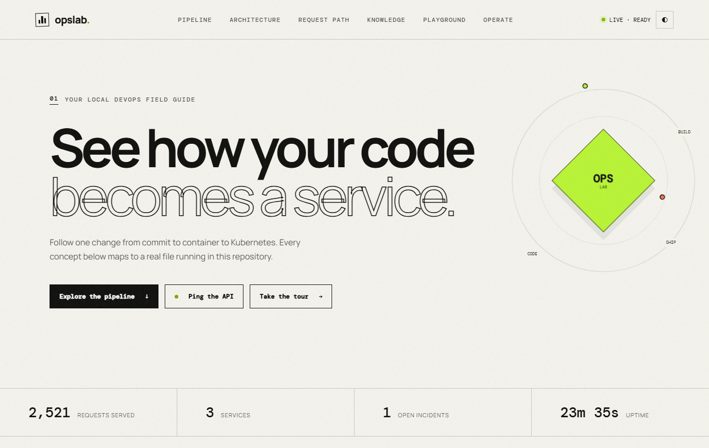
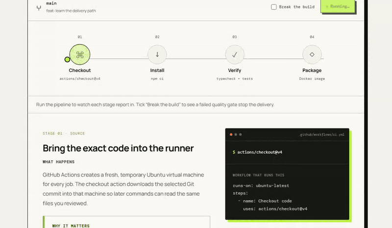
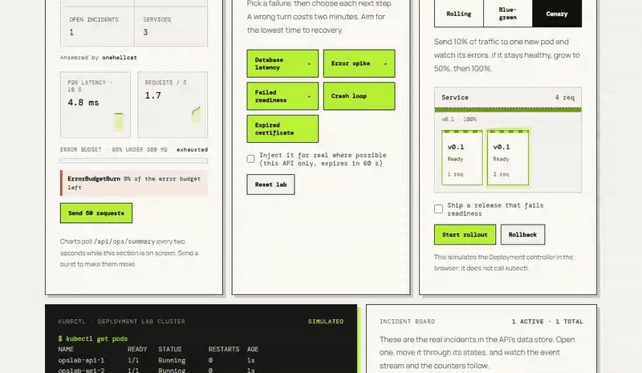
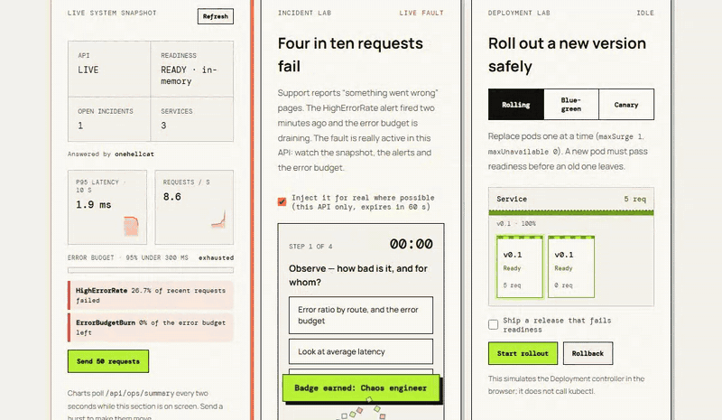
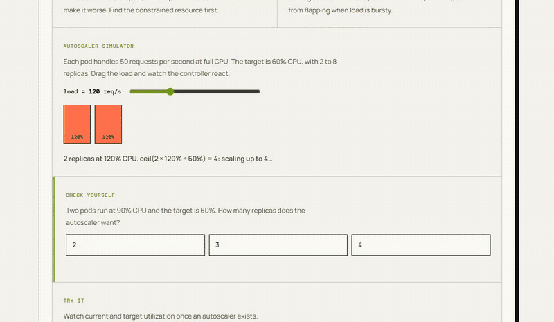

<div align="center">

# OpsLab

**Follow one service from a commit to a container to a Kubernetes cluster, and break it safely along the way.**

A hands-on DevOps field guide that runs entirely on your laptop. No cloud account, no bill.

[](https://github.com/onehellcat/opslab/actions/workflows/ci.yml)
[](LICENSE)


[Quick start](#-quick-start-in-60-seconds) · [Take the tour](#-a-quick-look) · [What you'll learn](#-what-youll-learn) · [Things to try](#-things-to-try-first)



</div>

## 👋 What is this?

Most DevOps tutorials teach one tool at a time. OpsLab shows how they fit together. It is a small, real service (a TypeScript API with PostgreSQL) packaged with everything around it: Docker, Compose, Kubernetes manifests, Terraform, CI, metrics, alerts, and traces.

On top sits an interactive guide in your browser. Every concept in it points at a real file in this repository, and most of them have something you can click, drag, or break.

- 🧪 **Play, don't just read.** Run a pipeline, ship a canary, fight an incident against the clock.
- 🔌 **It's all real.** The API, database, health probes, metrics, and CI in this repo are the ones the guide explains.
- 💥 **Safe to break.** Inject latency or errors into the running API and watch alerts fire. Every fault switches itself off.
- 🏠 **Local-first.** Your laptop and Docker are enough.

## 🎬 A quick look

**Run the pipeline, then break the build on purpose.** A failed quality gate stops the delivery before anything ships.



**Ship a canary release, then drive the cluster from a kubectl terminal.** Traffic moves to the new version 10% at a time.



**Fight a real incident against the clock.** The fault is injected into the running API, so the error budget and alerts react for real.



**Nine short lessons, each with a simulator and a check question.** Here the autoscaler adds and removes pods as load changes.



## 🚀 Quick start in 60 seconds

You need [Node.js 22+](https://nodejs.org/). That's it for the basic guide.

```bash
git clone https://github.com/onehellcat/opslab.git
cd opslab/app
npm ci
npm run dev
```

Open **http://localhost:3000** and press **Take the tour**.

<details>
<summary><b>Want the full stack?</b> PostgreSQL, Prometheus, Grafana, and Jaeger with Docker</summary>

With [Docker Desktop](https://www.docker.com/products/docker-desktop/) running:

```bash
# API + PostgreSQL
docker compose up --build

# ...plus Prometheus (9090), Grafana (3001), and Jaeger (16686)
docker compose --profile observe up --build
```

| Open | What you'll see |
| --- | --- |
| http://localhost:3000 | The guide and the API |
| http://localhost:3001 | Grafana, opening on the OpsLab dashboard (`admin` / `admin`) |
| http://localhost:9090/alerts | Prometheus alert rules |
| http://localhost:16686 | Jaeger traces. "Trace request" in the guide links straight to one |

Port 3000 taken? `OPSLAB_PORT=8080 docker compose up --build`

</details>

<details>
<summary><b>Want a real Kubernetes cluster?</b> k3d on your laptop</summary>

```powershell
./scripts/setup-k3d.ps1                     # create a local k3d cluster
docker build -t opslab-api:local app
k3d image import opslab-api:local -c opslab
./scripts/deploy-local.ps1                  # PostgreSQL, two API replicas, Service
```

Two API pods share one PostgreSQL database. See [kubernetes/README.md](kubernetes/README.md) for how to watch them take turns answering.

</details>

## 🧭 What you'll learn

| | Lesson | You'll try |
| --- | --- | --- |
| 01 | **Image vs. container** | Change a file and see which Docker layers rebuild |
| 02 | **Live is not ready** | Fail a readiness probe without restarting the pod |
| 03 | **Infrastructure as code** | Read the Terraform plan for a harmless change and a destructive one |
| 04 | **Names, ports, and services** | Follow a request through DNS, ports, and a Service |
| 05 | **Safe rollouts and rollback** | Rolling, blue-green, and canary releases, including a bad one |
| 06 | **Logs, metrics, and traces** | Watch latency, error budget, and alerts react to a fault |
| 07 | **Config and secrets** | Decode a Kubernetes Secret and see why base64 isn't encryption |
| 08 | **Scaling on demand** | Drag the load and watch an autoscaler add and remove pods |
| 09 | **Git as the source of truth** | Change the cluster by hand and watch GitOps put it back |

Finish a lesson by answering its check question. Your progress, badges, and best incident times are saved in your browser.

## 🎯 Things to try first

1. **Break the build.** Tick *Break the build* in the pipeline and watch it stop at Verify.
2. **Trace a request.** Press *Trace request* to see where the time goes, measured by the API itself.
3. **Inject a real fault.** In the incident lab, tick *Inject it for real* and pick *Error spike*. Then press *Send 50 requests* and watch the error budget drain.
4. **Ship a bad canary.** Choose *Canary*, tick *Ship a release that fails readiness*, and start the rollout. It aborts itself after touching only 10% of traffic.
5. **Use the terminal.** Type `kubectl get pods`, then `kubectl scale deployment/opslab-api --replicas=4`.
6. **Open an incident.** Use the incident board, then watch the live event stream and the counters update.

## 🗺️ How it fits together

```text
Developer → GitHub → GitHub Actions → Docker image → k3d / Kubernetes
                         │
                         └─ type check · API tests · browser tests · image scan · SBOM

Browser ──→ Fastify API ──→ PostgreSQL
               │
               ├─ /metrics ───────→ Prometheus ──→ Grafana + alert rules
               └─ OpenTelemetry ──→ Jaeger
```

<details>
<summary><b>What's in the repository</b></summary>

```text
opslab/
├── app/                 # Fastify API, the interactive guide, and its tests
├── kubernetes/          # Deployment, PostgreSQL StatefulSet, Services, PodDisruptionBudget
├── terraform/           # The same Kubernetes resources, managed by Terraform
├── observability/       # Prometheus scrape config and alerts, Grafana dashboard
├── scripts/             # k3d setup and deploy helpers
├── .github/workflows/   # CI
├── docker-compose.yml   # The full local stack
└── Makefile             # Common commands
```

| Area | What you'll find |
| --- | --- |
| Application | Fastify + TypeScript with health, service, incident, metrics, and fault-injection endpoints |
| Data | PostgreSQL 16 through a connection pool, in Compose and in Kubernetes |
| Delivery | GitHub Actions: type check, API tests, browser tests, image scan and SBOM, infrastructure validation |
| Orchestration | Probes, resource requests, a locked-down security context, and a PodDisruptionBudget |
| Observability | Labelled metrics, an error budget, alert rules, a Grafana dashboard, and traces |

</details>

<details>
<summary><b>API endpoints</b></summary>

| Endpoint | Purpose |
| --- | --- |
| `GET /health/live` | Is the process alive? |
| `GET /health/ready` | Can it serve work? Answers `503` when it cannot |
| `GET` / `POST /api/services` | List or create services |
| `GET` / `POST /api/incidents` | List or open incidents |
| `PATCH /api/incidents/:id` | Change an incident's title, severity, or status |
| `GET /api/ops/summary` | Live numbers for the guide: request rate, latency, error budget, alerts |
| `GET /api/events` | Server-Sent Events for incident, service, and fault changes |
| `GET` / `POST` / `DELETE /api/chaos` | Read, inject, or clear a self-expiring fault |
| `GET /metrics` | Prometheus metrics |

More detail in [app/README.md](app/README.md).

</details>

## 🛠️ Development

```bash
cd app
npm run lint        # type check
npm test            # API tests
npm run test:e2e    # browser tests (first time: npx playwright install chromium)
npm run build
```

The README GIFs are recorded from the running app with `node tests/tools/record-gifs.mjs` (needs Docker for the conversion).

<details>
<summary><b>Troubleshooting</b></summary>

- **Port 3000 is already in use.** Run the dev server on another port with `PORT=3001 npm run dev`, or set `OPSLAB_PORT` for Compose.
- **Incidents disappear when the dev server restarts.** That's expected with `npm run dev`: without a database the API keeps data in memory. Use Docker Compose for PostgreSQL.
- **"Inject it for real" is greyed out.** Fault injection is off in production builds. Compose turns it on with `OPSLAB_CHAOS=on`.
- **Grafana shows no data.** Prometheus needs a minute to scrape. Send some requests from the guide, then refresh.

</details>

## 🤝 Contributing

Ideas that make the lab clearer, safer, or more fun are welcome. Please read [CONTRIBUTING.md](CONTRIBUTING.md), run the checks above, and keep pull requests focused.

## 📄 License

[MIT](LICENSE). Use it, fork it, teach with it.
